<div align="center">

# Hobby Orbit

Explore your hobbies on a wheel and record moods, switches, and the things that draw you back

[![Live][badge-site]][url-site]
[![HTML5][badge-html]][url-html]
[![CSS3][badge-css]][url-css]
[![JavaScript][badge-js]][url-js]
[![Claude Code][badge-claude]][url-claude]
[![License][badge-license]](LICENSE)

[badge-site]:    https://img.shields.io/badge/live_site-0063e5?style=for-the-badge&logo=googlechrome&logoColor=white
[badge-html]:    https://img.shields.io/badge/HTML5-E34F26?style=for-the-badge&logo=html5&logoColor=white
[badge-css]:     https://img.shields.io/badge/CSS3-1572B6?style=for-the-badge&logo=css3&logoColor=white
[badge-js]:      https://img.shields.io/badge/JavaScript-F7DF1E?style=for-the-badge&logo=javascript&logoColor=black
[badge-claude]:  https://img.shields.io/badge/Claude_Code-CC785C?style=for-the-badge&logo=anthropic&logoColor=white
[badge-license]: https://img.shields.io/badge/license-MIT-404040?style=for-the-badge

[url-site]:   https://hobbyorbit.neorgon.com/
[url-html]:   #
[url-css]:    #
[url-js]:     #
[url-claude]: https://claude.ai/code

</div>

---

## Overview

Put your changing interests on a wheel, explore the activities inside them, and
record what you are drawn to today. A spin offers a suggestion; an explicit
check-in records your choice, feeling, trigger, and notes. Your journal starts
empty and stays on your device.

**Live:** hobbyorbit.neorgon.com

---

## Features

- **Nested wheel** -- Categories, outer activity bands, drill-in, zoom, and spins
- **Your arrangement** -- Add catalog or custom hobbies, reorder, change colors and icons
- **Check-ins** -- Choose a hobby or rest, describe a feeling, and add triggers and notes
- **Lock in** -- Keep the current hobby while continuing to explore suggestions
- **Observed patterns** -- Recorded sequences, transitions, moods, triggers, and seasons
- **Private sharing** -- Preview an update; notes are included only when selected
- **Install and go offline** -- Use the cached app after the first successful visit
- **Keep a copy** -- Full JSON backups, validated imports, and original-data recovery

## Install and keep your data

Open Settings and choose **Install app**. On iPhone and iPad, use the browser's
Share menu and **Add to Home Screen**. Installation support depends on the browser;
the same app also works in a browser tab. See [MDN's installation guide](https://developer.mozilla.org/en-US/docs/Web/Progressive_web_apps/Guides/Making_PWAs_installable).

Offline access is ready when Settings says so. Updates wait for a deliberate reload.
Your wheel and journal live in this browser on this device, without an account or
device sync. Download a backup before clearing browser data or moving devices.
An import replaces the current device's wheel and journal after confirmation.

The six-category starter wheel is editable sample content. It is not a record of
your interests. The catalog reuses [Aficion](https://aficion.neorgon.com/): 23
categories, 330 hobbies, and 178 deeper activities. Seasons use your check-ins'
recorded local dates and the hemisphere selected in Settings. Counts describe
what was recorded and do not claim to predict a switch or establish its cause.

---

## Running locally

ES modules require an HTTP server (not `file://`):

```bash
make serve
```

Or manually:

```bash
python3 -m http.server 8901
```

Visit `http://localhost:8901`. No build or package installation is needed to run it.

```bash
node --test tests/model.test.mjs
node scripts/build-catalog.mjs   # requires the sibling aficion-site checkout
node scripts/build-offline.mjs  # refresh after changing app files or assets
node scripts/build-offline.mjs --check
```

The generated catalog and offline asset list are committed. Hosting serves these
files directly. The service worker caches the app, catalog, and canonical fleet
styles; it never stores or transmits journal contents. Usage analytics is disabled.

---

## Architecture



```
hobbyorbit-site/
├── index.html          # Persistent app shell and forms
├── data/catalog.json   # Generated Aficion snapshot
├── css/                # App, wheel, and shared kit styles
├── js/
│   ├── app.js          # Entry point
│   ├── model.js        # Validated tree and journal mutations
│   ├── state.js        # Local persistence and recovery
│   ├── wheel.js        # SVG wheel controller
│   ├── render.js       # View updates
│   ├── events.js       # User actions
│   └── pwa.js          # Install, updates, and current-hobby favicon
├── sw.js               # Versioned offline shell
├── offline-assets.js   # Generated cache manifest
├── scripts/            # Catalog and offline snapshot generators
└── tests/              # Model and storage invariants
```

---

<div align="center">
<sub>Part of <a href="https://neorgon.com/">Neorgon</a></sub>
</div>
